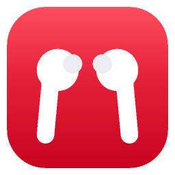
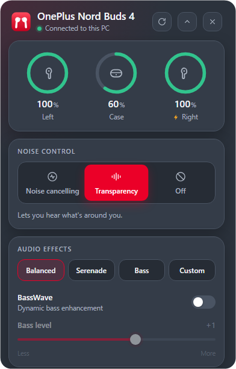
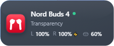

<p align="center">
  
</p>

<h1 align="center">Nord Buds Widget</h1>

<p align="center">
  A Windows desktop widget for <b>OnePlus Nord Buds 4</b>. Change noise control, EQ and other
  earbud settings from your PC, without the HeyMelody phone app.
</p>

<p align="center">
  
  &nbsp;&nbsp;
  
</p>
<p align="center"><sub>Expanded view (left) and the compact card that sits on the desktop (right)</sub></p>

---

## Features

- **Battery**: left, right and case.
- **Noise control**: Noise cancelling, Transparency or Off.
- **Audio effects**: EQ presets (Balanced, Serenade, Bass), a 10-band custom EQ, and the BassWave bass level.
- **Devices**: see which devices are connected. **Disconnect this PC** so your phone can take the earbuds, or **Connect to this PC** to get them back.
- **Find my earbuds**: play a sound on the buds. It stops on its own after 30 s.
- **Settings**: game mode, in-ear detection, dual connection.
- **Desktop widget**: a small card sits on the desktop behind your apps and expands when clicked. It starts when you sign in.

Other OnePlus, OPPO and realme earbuds that use HeyMelody may work too, but only Nord Buds 4 has been tested.

## Requirements

- Windows 10 or 11
- [Python 3.9+](https://www.python.org/downloads/windows/). It uses the standard library only, so there's nothing to `pip install`.
- Microsoft Edge (preinstalled on Windows) or Google Chrome
- The earbuds paired with the PC in **Settings → Bluetooth**

## Install

1. Download **NordBudsWidget-v2.0.zip** from the [latest release](https://github.com/akashlr92/NordBudsWidget/releases/latest), unzip it and open the `NordBudsWidget` folder. Or clone the repo:

   ```powershell
   git clone https://github.com/akashlr92/NordBudsWidget.git
   cd NordBudsWidget
   ```

2. Run the installer. It installs for the current user only and needs no admin rights:

   ```powershell
   powershell -NoProfile -ExecutionPolicy Bypass -File .\install.ps1
   ```

   Every line should show `[ok]`. Optional switches:
   - `-NoStartup`: don't start at sign-in
   - `-NoLaunch`: don't start the widget after installing

The installer copies the app to `%USERPROFILE%\NordBudsWidget` and creates **Nord Buds Widget** shortcuts on the Desktop, in the Start menu and in Startup.

> Using Claude Code? Open it in this folder and ask it to *"install the widget following INSTALL_WITH_CLAUDE_CODE.md"*.

### Pairing tips

1. Put the buds in the case with the lid open.
2. Hold the case button until the light flashes.
3. Choose **Add device** on the PC.
4. Turn off Bluetooth on your phone first, or the buds reconnect to the phone.

## Use

- The card sits at the **top right of the desktop, behind open apps**. Press **Win + D** to see it.
- **Click** the card to expand it. **Click elsewhere** or press **Esc** to shrink it. **Drag** it to move it.
- The **Nord Buds Widget** shortcut opens the widget in front of your apps.

## Uninstall

```powershell
powershell -NoProfile -ExecutionPolicy Bypass -File "$env:USERPROFILE\NordBudsWidget\uninstall.ps1"
```

Add `-KeepSettings` to keep `%APPDATA%\NordBudsWidget`, which holds the widget's position, its log and its browser profile.

## Troubleshooting

| Symptom | Fix |
|---|---|
| "Not connected to this PC" | The buds are in the closed case, asleep or connected elsewhere. Take them out, or press **Connect to this PC**. |
| "Earbuds are not answering" | Turn Bluetooth off and on on the PC. Close HeyMelody or the widget on any other device connected to the buds. **Refresh** retries at once. |
| `WSA 10048` in the log | Another program holds the buds' control channel, such as a second copy of the widget. Close it. |
| Widget is off-screen | Delete `%APPDATA%\NordBudsWidget\settings.json` and start it again. |
| Shortcut has a blank icon | Run `install.ps1` again, then press **F5** on the desktop. |

The log is at `%APPDATA%\NordBudsWidget\widget.log`.

## How it works

| File | Role |
|---|---|
| `nordbuds_widget.pyw` | Opens the earbuds' RFCOMM control service `0000079A-D102-11E1-9B23-00025B00A5A5`, the same one HeyMelody uses, and speaks the OPPO/OnePlus frame protocol. It serves the UI on `127.0.0.1` with a random port and token, and hosts it in an Edge app window kept on the desktop layer. |
| `nordbuds_ui.html` | The widget's interface: compact card and expanded view. |
| `bt_audio.py` | Connects or disconnects the PC's Bluetooth audio through the Windows audio stack. No admin needed. |
| `desk_colors.py` | Samples the screen behind the card's corners so the rounded corners blend in. |
| `make_icon.py` | Redraws `nordbuds.ico` and `nordbuds.png`. |
| `install.ps1` / `uninstall.ps1` | Per-user install and removal. |

### Limitations

- The Nord Buds 4 firmware ignores the "switch to device" command, so the widget can't move the buds straight to your phone. It can disconnect **this PC** instead and keep it off for 2 minutes, which lets the other device take over.
- Only one copy of the widget can talk to the buds at a time.

## Credits

The protocol is based on community reverse engineering of OPPO/OnePlus earbuds, including the
[Gadgetbridge](https://codeberg.org/Freeyourgadget/Gadgetbridge) project.

## License

[MIT](LICENSE) © 2026 Akash L R

## Disclaimer

This is an unofficial hobby project. It isn't affiliated with or endorsed by OnePlus or OPPO.
"OnePlus", "Nord Buds" and "HeyMelody" are trademarks of their owners. Use at your own risk.
